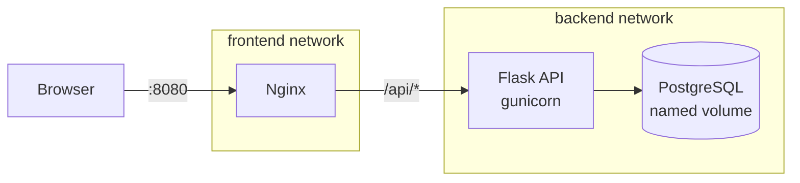
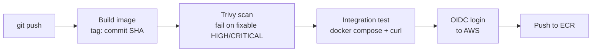

# Gym Booking — Containerized 3-Tier App with CI/CD to Amazon ECR

A gym class-booking app built as a **multi-container Docker application** (Nginx → Flask API → PostgreSQL) with a **GitHub Actions** pipeline that builds the image, **scans it with Trivy**, runs an **integration test** against the full stack, and pushes it to **Amazon ECR** using **GitHub OIDC** — no AWS keys stored anywhere.


---

## Architecture



- **Nginx** serves the static booking page and reverse-proxies `/api/*` to the API.
- **Flask API** (gunicorn) exposes `/health`, `/classes`, `/bookings`.
- **PostgreSQL** stores classes and bookings in a named volume.
- **Two networks:** Nginx can reach the API but **not** the database. Only port 8080 is published to the host.

## CI/CD Pipeline



Every image in ECR is traceable to a commit, has passed a vulnerability gate, and has been tested as part of the running stack.

---

## Tech Stack

| Area | Tools |
|---|---|
| Containers | Docker (multi-stage builds), Docker Compose |
| App | Python, Flask, gunicorn, PostgreSQL 16, Nginx |
| CI/CD | GitHub Actions |
| Security | Trivy, non-root containers, SHA-pinned third-party action |
| Cloud | Amazon ECR, AWS IAM, GitHub OIDC |

---

## Key Engineering Decisions

| Decision | Why |
|---|---|
| **Multi-stage Dockerfile** | Build tooling stays out of the runtime image. |
| **Non-root user** in the container | A compromised app doesn't get root inside the container. |
| **`apt-get upgrade` in the runtime stage** | OS packages are patched at build time, not only when the base image is refreshed. |
| **Healthchecks + `depends_on: service_healthy`** | The API waits until Postgres is *ready*, not just *started*; Nginx waits for a healthy API. |
| **Network segmentation** | The proxy tier has no network path to the database. |
| **Secrets in `.env`** (git-ignored) | The real database password never reaches the repo. |
| **Row lock (`SELECT … FOR UPDATE`)** on booking | Two users can't take the last spot in a class at the same time. |
| **Trivy gate on fixable HIGH/CRITICAL only** | Blocks real, actionable risk without permanently failing on issues no one can fix yet. |
| **Integration test uses the scanned image** (`--no-build`) | The exact image that passed the scan is the one tested and pushed. |
| **OIDC + least-privilege IAM role** | No stored credentials; the role can only push to one ECR repository, from this repo's `main` branch. |
| **Trivy action pinned to a commit SHA** | Tags can be moved; SHAs can't (see [troubleshooting](docs/troubleshooting.md)). |
| **ECR lifecycle policy** | Old images are expired automatically to control storage cost. |

---

## Run Locally

Requires Docker Desktop.

```bash
git clone https://github.com/alfi-teachs/gym-booking-docker.git
cd gym-booking-docker
cp .env.example .env        # then set a password (letters and numbers)
docker compose up -d --build
```

Open **http://localhost:8080**, enter a name and book a class.

```bash
docker compose ps           # db and api should show (healthy)
docker compose down         # stop (data is kept in the volume)
docker compose down -v      # stop and delete the data
```

### API

| Method | Endpoint | Description |
|---|---|---|
| GET | `/api/health` | API and database status |
| GET | `/api/classes` | Classes with booked/capacity counts |
| GET | `/api/bookings` | All bookings |
| POST | `/api/bookings` | `{"class_id": 1, "member_name": "Alfi"}` → 201, or 400 / 404 / 409 (full) |

---

## Repository Structure

```
gym-booking-docker/
├── .github/workflows/build.yml   # build → scan → test → push to ECR
├── api/
│   ├── app.py                    # Flask API
│   ├── requirements.txt
│   ├── Dockerfile                # multi-stage, non-root, healthcheck
│   └── .dockerignore
├── frontend/index.html           # booking page
├── nginx/nginx.conf              # static files + reverse proxy
├── docker-compose.yml            # db + api + nginx, 2 networks, 1 volume
├── .env.example
└── docs/
    ├── docker.md                 # containers, Compose, networking
    ├── ci-pipeline.md            # every workflow step explained
    ├── aws-setup.md              # ECR, IAM role, OIDC trust
    └── troubleshooting.md        # real problems hit and how they were solved
```

---

## Documentation

- **[Docker & Compose](docs/docker.md)**
- **[CI pipeline](docs/ci-pipeline.md)**
- **[AWS setup](docs/aws-setup.md)**
- **[Troubleshooting](docs/troubleshooting.md)**

---

## Future Improvements

- [ ] Deploy the image from ECR to EC2 / ECS
- [ ] Infrastructure as code with Terraform
- [ ] Dependabot to keep pinned action SHAs and base images up to date
- [ ] Unit tests for the API in the pipeline
- [ ] Move to Kubernetes
